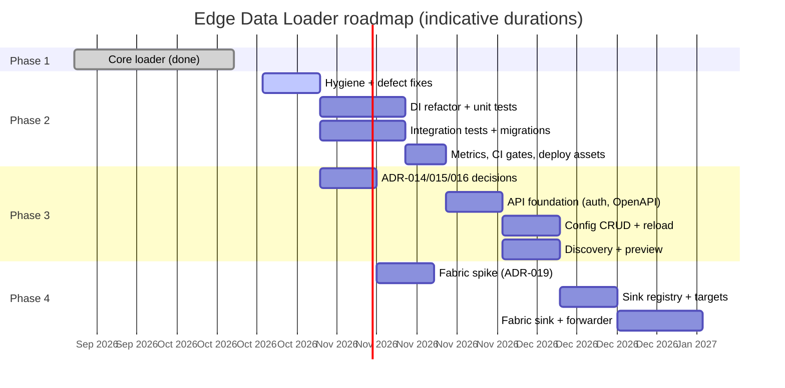

# Implementation Plan

| Item | Value |
|------|-------|
| Document | 03 – Implementation Plan |
| Version | 1.0 |
| Last updated | 2026-10-14 |
| Related | [01 Requirements](01-project-requirements.md) · [02 Architecture](02-architecture.md) · [04 AI Rules](04-ai-rules.md) · [05 Decisions](05-decisions.md) |

| Phase | Theme | Status |
|-------|-------|--------|
| 1 | Core loader: four sources, MSSQL sink, metadata, scheduling, ops endpoints | ✅ Complete |
| 2 | Engineering quality: AI-rules compliance, tests, defect fixes, observability, CI gates | ⬜ Next |
| 3 | Remote configuration API with schema discovery and top-10 preview | ⬜ Planned |
| 4 | Multiple sinks, including Microsoft Fabric | ⬜ Planned |

The durations assume one developer working with AI assistance. They are planning estimates, not commitments.

---

## Phase 1 — Core loader ✅

Built iteratively between 2026-09-16 and 2026-10-14. These items reconstruct what was delivered, in the order a from-scratch build would follow.

- [x] Create project structure (`cmd/`, `internal/`, `pkg/contracts`, Go module `github.com/slaghuis/data-loader`)
- [x] Add configuration module: environment variables plus `$env:` secret references (`internal/config`)
- [x] Add logging module: slog JSON/text output, a context-scoped logger, and an asynchronous DB mirror (`internal/logging`)
- [x] Define domain contracts: `Source`, `Sink`, `Batch`, `Watermark`, `LoadMode` (`pkg/contracts`)
- [x] Create the metadata models and repository: sources, loads, watermarks, runs, logs, Modbus tags, OPC UA nodes (`internal/metadata`)
- [x] Create the database schema with GORM AutoMigrate
- [x] Source registry with self-registering modules (`internal/sources/registry.go`)
- [x] SQL Server source: delta with an upper-bound snapshot, append and replace, GUID and decimal handling
- [x] PostgreSQL source: identifier quoting, type mapping, TIMESTAMPTZ normalised to UTC
- [x] Modbus TCP source: decoding by register type and data type, byte and word order, scaling, bad-quality rows
- [x] OPC UA source: batch reads, timestamp fallback, quality mapping, username auth, security policies
- [x] MSSQL sink: auto-create table, truncate, bulk copy, `yb_load_timestamp`
- [x] Pipeline runner: run lifecycle, watermark handling, run state
- [x] Cron scheduler with overlap guard
- [x] Health, readiness and status HTTP endpoints
- [x] Retention housekeeping (batched deletes)
- [x] Metadata hot reload (SHA-256 fingerprint, periodic and on SIGHUP)
- [x] YAML seeding CLI with strict parsing and transactional upserts
- [x] Dagger CI pipeline (`pipeline/`, `pipeline-lib v0.1.2`) and `pipeline.yaml`
- [x] Documentation set (`docs/01`–`05`)

**Baseline at the end of Phase 1 (measured 2026-10-14):** `go build ./...` and `go vet ./...` pass. There are **0 test files** across 19 packages. `gofmt -l` lists all 27 Go files, because they have CRLF line endings. `pipeline.yaml` has `coverage_min: 0` and `integration.enabled: false`, and references a `./deploy/k8s` directory that does not exist.

---

## Phase 2 — Engineering quality and AI-rules compliance

**Goal:** bring the codebase into full compliance with [04 AI Rules](04-ai-rules.md) and make it safe to extend in Phases 3 and 4. Phase 2 adds no new features beyond observability.

### 2.1 Code hygiene

- [ ] Add a `.gitattributes` file (`*.go text eol=lf`), then renormalise line endings and run `gofmt -w` in a single commit with no logic changes.
- [ ] Add a `.golangci.yml` file enabling `errcheck`, `govet`, `staticcheck`, `revive` (exported-symbol docs), `gosec`, `bodyclose`, `contextcheck`, `errorlint`, `gocyclo` (threshold 15) and `misspell`.
- [ ] Remove dead code: `config.ResolveSecrets`, the unreachable `errFirstRunInit` / `IsFirstRunInit` path in `sqlserver`, and the `sql.ErrNoRows` branch in the runner (D-10, D-13).
- [ ] Inject the build version with `-ldflags "-X main.version=…"` and report it in `/status` (D-12).
- [ ] Rename the README to `README.md` and split the module design notes into `docs/modules/*.md`.

### 2.2 Defect register

These defects were found by reviewing the code while writing this documentation. Severity reflects the impact on data correctness first and operability second. Every fix must come with a regression test.

| ID | Severity | Location | Defect | Fix |
|----|----------|----------|--------|-----|
| D-01 | **High** | `internal/logging/dbhandler.go` (`WithAttrs`, `Handle`) | Attributes added with `logger.With(...)` reach the console handler but are **not** stored in the DB entry. `Handle` only sees the record's own attributes. The runner attaches `load_id`, `source_id`, `run_uuid` and `load_name` with `With`, so those columns in `meta_log_entries` are mostly NULL and runs cannot be correlated with their logs. | Store the accumulated attributes (and the group prefix) in `DBHandler` and merge them in `Handle`. |
| D-02 | Medium | `cmd/loader/main.go` (final log line), `dbhandler.go` (`Close`) | `dbHandler.Close` closes the channel, and the next line logs `data-loader stopped`. That sends on a closed channel, so **every graceful shutdown ends in a panic**. | Add a `closed` flag guarded by a mutex or `atomic.Bool`, and skip the DB enqueue after close. |
| D-03 | **High** | `internal/sources/sqlserver/source.go` (`currentMaxWatermark`, numeric case) | The numeric watermark is scanned into `float64` and formatted with `%v`. Values ≥ 1,000,000 become `1.234567e+06` (confirmed with the Go 1.26 toolchain), and values above 2^53 lose precision. Comparing an `int`/`bigint`/`decimal` column with that string parameter is **expected to fail with a conversion error** (to be confirmed by integration test). Precision loss can also skip or duplicate rows. | Scan into `sql.NullString` and cast in SQL (`CONVERT(varchar(40), MAX(col))`). Store the watermark verbatim. Bind it typed (`int64` or a decimal string). |
| D-04 | Medium | `internal/pipeline/runner.go` (watermark step) | A failed `UpsertWatermark` is logged as a warning, but the run is still marked `success`. The next run re-reads the same window and **duplicates rows**. | Fail the run (status `failed`, error recorded). |
| D-05 | Medium | `runner.go` (first-batch handler) | `replace` truncates only when the first batch arrives. A source that returns 0 rows leaves the **stale previous contents**. Truncate and insert are also not atomic: a failure mid-load leaves a partial table. | Truncate before reading (once the target is ensured). For atomicity, load into `<table>__staging` and swap with `sp_rename` inside a transaction (ADR-020, to be written). |
| D-06 | Low | `seeds/seed.yaml` | Uses `enabled:`, but the strict parser (`KnownFields(true)`) only accepts `is_enabled:`. The **default `-file` of `cmd/seed` fails to parse**. | Fix the sample, and add a test that parses every file in `seeds/`. |
| D-07 | Medium (High before Phase 3) | `sqlserver/source.go` (`sanitizeObject`, query builders), `sink/mssql.go` (DDL, truncate), `postgres/source.go` (`quoteQualifiedIdent`) | Identifiers are wrapped in `[...]` without escaping `]`. The comment claims suspicious input is rejected, but it is not. Postgres passes through any name containing `"` unchanged. Column names come from the source result set. The risk is acceptable while only DBAs write metadata, but it **must be fixed before the API accepts identifiers**. | Add `quoteMSSQLIdent` (replace `]` with `]]`) and a strict identifier validator (`^[\p{L}_][\p{L}\p{N}_@$# .-]{0,127}$`), and always quote. Fuzz-test the validator. |
| D-08 | Medium | `sqlserver/source.go` (`buildDSN`) | The DSN is built with `Sprintf` without URL escaping. Passwords containing `@ : / ? #` break the connection string. | Build the DSN with `net/url` (as the Postgres module already does). |
| D-09 | Medium | `internal/scheduler/scheduler.go` (`trigger`, `Stop`) | Runs use `context.Background()`, and the context returned by `cron.Stop()` is ignored. On shutdown, in-flight runs are killed and left as `running` in `meta_load_runs` permanently, because housekeeping never prunes `running` rows. | Use a scheduler-owned cancellable context. In `Stop`, wait up to `LOADER_SHUTDOWN_TIMEOUT_SEC` and then mark the remaining runs `aborted`. At startup, mark orphaned `running` rows `aborted`. |
| D-10 | Low | `runner.go` (`GetWatermark` error check) | Checks `sql.ErrNoRows`, but the repository returns `(nil, nil)` when no row exists. This is a dead branch. | Remove it. |
| D-11 | Low | `internal/runstate/registry.go` (`Snapshot`) | The comment says the output is sorted, but it iterates a map, so `/status` order is random. | Sort by `LoadID`. |
| D-12 | Low | `cmd/loader/main.go` (health server construction) | The version is hard-coded to `"dev"`. | Inject it with ldflags (see 2.1). |
| D-13 | Low | `internal/config/secrets.go` | `ResolveSecrets` is unused, and it silently resolves missing variables to `""`, unlike `ResolveParams`. | Delete it. |
| D-14 | Low (architecture) | `sources/modbus`, `sources/opcua` | Package-level `tagRepo` / `nodeRepo` globals are set from `main`. This is hidden coupling and blocks parallel tests. | Inject a `PointCatalog` (see [02 – Interface Definitions](02-architecture.md#interface-definitions)). |
| D-15 | Low | all `*.go` files | CRLF line endings: `gofmt -l` reports every file. | See 2.1. |
| D-16 | Medium | `pipeline.yaml` | `coverage_min: 0`, `integration.enabled: false`, and `deploy.manifests: ./deploy/k8s` does not exist. | Raise to 80 and enable integration once the tests exist. Add the `deploy/` assets. |
| D-17 | Info (performance) | `runner.go` (source construction) | A source is built, opened and closed **on every run**. The README's design notes say the Modbus/OPC UA connection "stays open for the next tick", which is not what the code does. For OPC UA at 1–5 s intervals this means a full session handshake (and secure-channel crypto) per poll. | Correct the README now. Consider a per-source connection cache with idle eviction (ADR-021, to be written) after load testing. |
| D-18 | Low | `postgres/source.go` | Delta has no upper-bound snapshot (unlike SQL Server). Numeric watermarks also go through `float64`, which loses precision above 2^53. | Align with the SQL Server strategy and keep numerics as strings. |
| D-19 | Medium | `internal/metadata/repository.go` (`ListEnabledLoads`) | Filters on `meta_loads.is_enabled` only, so **disabling a source does not stop its loads**. | Join on `meta_sources.is_enabled = 1` and include it in the fingerprint (already included). |

### 2.3 Dependency injection and Clean Architecture

- [ ] Introduce narrow interfaces in consuming packages: `pipeline.RunStore`, `pipeline.SourceBuilder`, `scheduler.LoadCatalog`, `scheduler.Executor`, `housekeeping.Pruner`, `logging.LogWriter`.
- [ ] Replace the Modbus/OPC UA repository globals with an injected `contracts.PointCatalog`, so the adapters no longer import `internal/metadata` (D-14).
- [ ] Move domain rules (first-run initialisation, forced append, watermark advance) into tested functions in `pkg/contracts` or a new `internal/domain`.
- [ ] Inject a clock (`func() time.Time`) where time affects behaviour (runner, housekeeping, watermark lag).

### 2.4 Tests

- [ ] Unit tests per [02 – Testing Requirements](02-architecture.md#testing-requirements), table-driven, stdlib `testing` plus `github.com/google/go-cmp`.
- [ ] Fakes for `Source`, `Sink`, `RunStore` and `LoadCatalog` in `internal/testutil` (hand-written; no mocking framework).
- [ ] Integration suites under `test/integration` (build tag `integration`) with `testcontainers-go`: SQL Server, PostgreSQL, the in-process Modbus server, and an OPC UA simulator.
- [ ] Failure tests (source, sink or metadata outage; SIGTERM mid-run) and load tests (see 02).
- [ ] Fuzz tests: identifier validation/quoting (D-07), Modbus decoding, seed parsing.
- [ ] Gate: `go test -race ./...` with ≥ 80% coverage per package, excluding `cmd/`.

### 2.5 Versioned migrations

- [ ] Adopt `pressly/goose` v3 with embedded SQL migrations in `migrations/` (ADR-012).
- [ ] Baseline migration `0001` equals the current AutoMigrate schema (generated, then hand-reviewed). Detect existing databases and mark them as baselined.
- [ ] Add explicit foreign keys and an index on `meta_load_runs(status, started_at)`.
- [ ] Remove `AutoMigrate` from the startup path. `loader migrate up|status` becomes an explicit step.

### 2.6 Observability

- [ ] Prometheus `/metrics` on the health server (metric list in [02 – Monitoring](02-architecture.md#monitoring-requirements)).
- [ ] An alert rule file (`deploy/monitoring/alerts.yaml`) and a Grafana dashboard JSON.
- [ ] A counter for dropped DB log records.

### 2.7 Delivery assets and CI

- [ ] `deploy/systemd/data-loader.service`, `deploy/k8s/` (Deployment with `replicas: 1`, `strategy: Recreate`, liveness probe on `/healthz`, readiness on `/readyz`, Secret-mounted environment).
- [ ] `pipeline.yaml`: `coverage_min: 80`, `integration.enabled: true`.
- [ ] Dockerfile review: distroless base image, non-root user, `HEALTHCHECK`.

### 2.8 Documentation

- [ ] Godoc on every exported identifier (enforced by `revive`).
- [ ] Package `doc.go` for each package explaining its responsibility and invariants.
- [ ] Runbook `docs/runbook.md`: stuck runs, watermark rewind, adding a site, rotating secrets.
- [ ] Update this plan and the defect register as items close.

### Phase 2 exit criteria

1. All **High** and **Medium** defects closed, each with a regression test.
2. `golangci-lint run` and `gofmt -l` are clean. `go test -race ./...` passes with ≥ 80% coverage per package.
3. Integration suite green in CI for all four sources and the MSSQL sink.
4. `/metrics` is live and the alert rules are committed.
5. No package-level mutable dependencies remain, and the application layer depends only on interfaces.

---

## Phase 3 — Remote configuration API

**Goal:** a separate application can fully manage sources and loads, discover source schemas, and preview the top 10 rows (FR-020 to FR-026).

### 3.0 Decisions before code

- [ ] **ADR-015 Connectivity model.** Agree with site OT security how the configuration app reaches the loader (inbound to the site network or DMZ, or an outbound-initiated relay). This blocks deployment, not development.
- [ ] **ADR-014 Authentication.** Register an Entra ID app, define the scopes, and decide whether mTLS is required.
- [ ] **ADR-016 Secrets.** Choose the secret store for credentials created through the API.

### 3.1 Foundation

- [ ] `internal/api` on the standard library `net/http` router (Go 1.22+ method and path patterns; no framework, ADR-013).
- [ ] An `openapi.yaml` contract written first. Generate request/response types with `oapi-codegen` (types only) and validate handlers against the contract in tests.
- [ ] Middleware: request ID, structured access log (category `api`), panic recovery to `500 problem+json`, JWT validation with a cached JWKS, scope checks, per-client rate limiting for discovery and preview, and request body size limits.
- [ ] TLS configuration (TLS 1.2 minimum) with optional client-certificate verification.
- [ ] `meta_audit_events` migration and an audit writer.
- [ ] `rowversion` columns and ETag / `If-Match` handling.

### 3.2 Configuration CRUD

- [ ] Source-kind registry with a JSON Schema for each kind's params (`GET /source-kinds`). Validation shares that schema.
- [ ] Source CRUD with write-only secrets (ADR-016).
- [ ] Load CRUD with validation: cron (`cron.ParseStandard` plus descriptors), mode/watermark consistency, identifier validation (D-07), and target collisions (two loads writing the same target with `replace`).
- [ ] Atomic replacement of Modbus tag and OPC UA node lists.
- [ ] An application service that wraps repository writes and calls `Scheduler.Reload(ctx)` synchronously before responding.
- [ ] Converge seeding and the API on the same application service, so `cmd/seed` and the API share validation.

### 3.3 Discovery and preview

- [ ] `contracts.SchemaDiscoverer`, `Previewer` and `ConnectionTester` (ADR-017).
- [ ] SQL Server: `sys.objects`, `sys.columns`, `sys.types`, `sys.indexes` and `sys.partitions` for objects, columns, PK, indexes and approximate row counts. Preview with `SELECT TOP (@n)` under `ApplicationIntent=ReadOnly`.
- [ ] PostgreSQL: `information_schema` plus `pg_catalog` (`pg_index`, `pg_class.reltuples`). Preview with `LIMIT $1` inside `BEGIN READ ONLY` and a `SET LOCAL statement_timeout`.
- [ ] Watermark candidate ranking: non-null datetime columns first (indexed ones before unindexed), then identity or ever-increasing numeric PKs (flagged "inserts only").
- [ ] Modbus/OPC UA: return the fixed telemetry schema. Preview performs one live poll of the supplied tags or nodes (read-only).
- [ ] `proposed_target.create_table_ddl` generated by the sink's type mapper.
- [ ] Cap preview at 10 rows, truncate values at 4 KiB, apply the timeout, write an audit event, and rate-limit.

### 3.4 Operations endpoints

- [ ] Run now (respects the overlap guard; returns 202 with `run_uuid`), enable/disable, and watermark reset (mandatory reason, optional explicit value).
- [ ] Run, log and audit queries with cursor pagination.

### Phase 3 exit criteria

1. OpenAPI contract published, with contract tests green.
2. US-002 and US-005 acceptance criteria automated.
3. A security review (`gosec`, a manual review of auth, preview and secrets) shows no open High findings.
4. The configuration app team has signed off on the contract.

---

## Phase 4 — Multiple sinks including Microsoft Fabric

**Goal:** deliver each load to one or more sinks, including Microsoft Fabric, without re-reading sources, and keep local loads independent of WAN availability (FR-030 to FR-033).

### 4.0 Spike (time-boxed to 2 weeks) — validates ADR-019

- [ ] Write Parquet (`github.com/parquet-go/parquet-go` or Apache Arrow Go `pqarrow`) with the canonical type mapping.
- [ ] Upload to a Fabric **Open Mirroring** landing zone through the OneLake ADLS Gen2 endpoint (`azdatalake` from the Azure SDK for Go) with a service principal. Verify `_metadata.json` (key columns), sequential file naming, and `__rowMarker__` semantics for insert/upsert/delete against the *current* Microsoft documentation.
- [ ] Measure the time until rows are queryable in the SQL analytics endpoint, plus throughput, file-size guidance and cost.
- [ ] Evaluate the alternatives head-to-head: a Fabric Warehouse via TDS (reusing go-mssqldb with Entra ID auth; check bulk-load support and data-type restrictions) and Eventstream (Event Hubs protocol) for high-frequency telemetry.
- [ ] Record the outcome by updating ADR-019 to Accepted or Rejected.

### 4.1 Sink registry and targets

- [ ] `meta_sinks`, `meta_load_targets`, `meta_target_cursors` and `meta_target_runs` migrations. The upgrade migration creates `local` plus one target per load, so behaviour is unchanged (see [02 – Phase 4 additions](02-architecture.md#phase-4-additions-target)).
- [ ] A sink registry mirroring the source registry. `SinkCapabilities`, `Flusher`.
- [ ] Runner fan-out for **direct** targets (local LAN sinks): each batch goes to every direct target, and per-target results are recorded. The run fails only if the **primary** target fails.
- [ ] API: `/sinks`, `/loads/{id}/targets` (built on the Phase 3 foundation).

### 4.2 Fabric sink and forwarder

- [ ] `internal/sink/fabric`: buffer batches into a Parquet file per target per run (rolling at `LOADER_FORWARDER_MAX_BATCH_ROWS`), upload, then commit by sequence number.
- [ ] `internal/delivery/forwarder`: for **forward** targets, read rows from the local sink table with `yb_load_timestamp > cursor` in order and deliver them in files. Advance `meta_target_cursors` only after the upload is confirmed (at-least-once, ADR-018).
- [ ] Map write modes: `append` → insert marker; `delta` with `key_columns` → upsert marker; `replace` → a new mirrored table generation (documented limitation).
- [ ] Map types to Parquet (see [02 – Canonical type mapping](02-architecture.md#canonical-type-mapping)), with GUIDs as strings and timestamps in UTC microseconds.
- [ ] Backlog metrics, a lag alert, and a `/readyz` sub-status that reports remote sinks without failing readiness.

### 4.3 Hardening

- [ ] WAN-loss test (US-006), large-backlog drain test, and credential-rotation test.
- [ ] Fabric capacity and cost guidance in `docs/modules/fabric.md`.

### Phase 4 exit criteria

1. US-006 automated against a Fabric test workspace (nightly).
2. Loads with only a `local` target behave identically to Phase 3 (regression suite).
3. ADR-018 and ADR-019 Accepted.

---

## Backlog

- Cloud metadata sync and log shipping (the original README's "next step"). Consider whether the Phase 3 API plus Phase 4 forwarding cover the need.
- OPC UA certificate authentication, session auto-reconnect, and address-space browsing (would add discovery for OPC UA).
- Modbus block-read optimisation (group contiguous registers).
- Schema-drift detection: alert, then optionally `ALTER TABLE ADD COLUMN`.
- Leader election to allow an active/passive pair per site.
- Retry policy per load (backoff within a tick).
- Per-column type overrides (for example `DECIMAL(p,s)` instead of `decimal(38,10)`).
